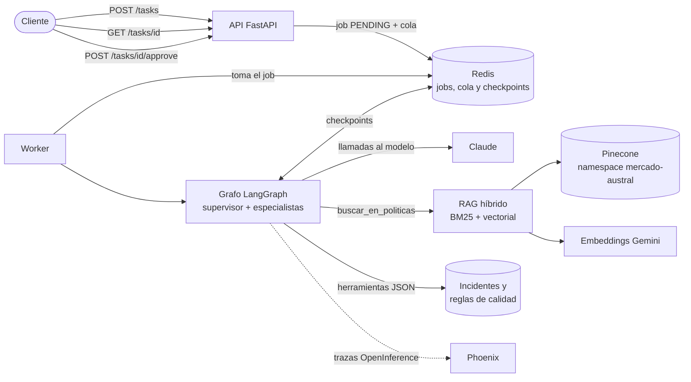

# Sistema Intelligence de grado de producción: RAG híbrido + agentes con supervisor + API asíncrona

Entrega final del curso de AI Engineering. Integré en un solo servicio lo que fui construyendo módulo a módulo: un **RAG híbrido**
(Pinecone + BM25) sobre las políticas de gobierno de datos de Mercado Austral S.A. (una empresa **ficticia**), un
**orquestador multi-agente con supervisor** (LangGraph), una **API asíncrona** (FastAPI + worker + cola en Redis), **trazabilidad**
completa en Arize Phoenix, **checkpoints** en Redis y un paso de **aprobación humana** antes de ejecutar acciones con efecto externo.

Se levanta con una instrucción (`./run.sh`) y lo probé de punta a punta en mi computadora: las 6 corridas de evidencia están
en [docs/evidencia/corridas.md](docs/evidencia/corridas.md).

## Decisiones principales

| Tema | Qué decidí | Por qué |
|---|---|---|
| Qué es el sistema | Un asistente de Gobierno de Datos que contesta con **dos fuentes**: los datos operativos (incidentes y reglas de calidad, vía herramientas JSON) y las **políticas escritas** (vía RAG). | Las dos fuentes responden preguntas distintas. "¿Cuántos incidentes críticos hay?" sale de los datos; "¿qué plazo fija la política?" sale de los documentos. Combinarlas es lo que hace útil al sistema. |
| Cómo se integra el RAG | El RAG es **una herramienta más del investigador** (`buscar_en_politicas`), no un camino aparte. | El supervisor sigue decidiendo qué especialista interviene; el RAG no duplica la orquestación. Y como es una herramienta, Phoenix lo traza solo. |
| RAG sin costo | **Pinecone Starter** (plan gratuito, índice serverless) y **embeddings de Gemini** (`gemini-embedding-001`, cuota gratuita). | La consigna pide un sistema real, no gastar en infraestructura. Con las dos cuotas gratuitas el indexado (36 fragmentos de 13 documentos) y las consultas del curso no cuestan nada. |
| Recuperación híbrida | **BM25 + vectorial** combinados por rango recíproco (RRF, `EnsembleRetriever`). | Los códigos (`GD-POL-001`) y los términos exactos los encuentra mejor BM25; las paráfrasis, la búsqueda semántica. Juntas cubren ambos casos. |
| Citas verificables | Cada fragmento trae su cita (`código (archivo, pág. N)`) y un validador **rechaza** un informe que cite un código `GD-XXX-NNN` que el investigador no recuperó. El resultado del job lista `fuentes_citadas`. | Un RAG que puede inventar una fuente es peor que no tenerlo. La validación es determinista, no depende de que el modelo "se acuerde". |
| Cómo corre el agente | La API **no** corre el grafo: `POST /tasks` registra el job y lo encola en Redis; lo ejecuta un **worker** en otro proceso. | Un flujo de agentes tarda decenas de segundos. Con cola y worker, la API responde en milisegundos, un reinicio de la API no pierde nada y se pueden sumar workers. |
| Async de verdad | Nada bloquea el *event loop*: las llamadas al modelo, a Redis y al RAG son `async`; el cliente de Pinecone (síncrono) corre en un hilo (`asyncio.to_thread`). | Una llamada bloqueante dentro de la API congela a todos los demás pedidos. Encontré que `langchain-pinecone` reutiliza una sesión HTTP asíncrona entre búsquedas y la aislé en [rag/vectorstore.py](rag/vectorstore.py). |
| Contratos con Pydantic | Entradas y salidas de la API, de las herramientas y del RAG son modelos Pydantic estrictos (`extra="forbid"`, límites de largo, `Literal`). El esquema OpenAPI exportado está en [docs/openapi.json](docs/openapi.json) y un test falla si el código lo cambia sin regenerarlo. | La validación en los bordes evita que un dato mal formado llegue al modelo, y los errores 404, 409 y 503 salen con un formato único (`ErrorApi`); el 422 usa el formato estándar de FastAPI, que detalla qué campo falló. |
| Estados del job | `PENDING` → `RUNNING` → (`WAITING_APPROVAL` →) `DONE` o `FAILED`. El job se guarda como `PENDING` **antes** de encolarse. | Nunca hay un mensaje en la cola sin registro. Cualquier excepción, timeout o worker muerto termina en `FAILED` con el motivo. |
| Persistencia | **Checkpointer de Redis** (`AsyncRedisSaver`): `thread_id = job_id`. Redis guarda además el registro del job y la cola. | El `job_id` une todo: el job, su checkpoint y su traza. La pausa de aprobación vive en Redis, no en memoria. |
| Aprobación humana | El grafo se pausa con `interrupt` en `aprobacion_humana`; `POST /tasks/{id}/approve` entrega la decisión y el worker retoma. Si rechazan, el job termina `DONE` sin ejecutar nada. | Escalar un incidente crítico es una acción con efecto externo (simulada): conviene que la revise una persona. |
| Observabilidad | **Arize Phoenix** con OpenInference. Cada nodo, llamada al modelo, herramienta y recuperación es un *span*; todo cuelga de **una** traza por job. | Se engancha a LangGraph sin decorar funciones. Intenté primero un span manual para el RAG y quedaba huérfano en otra traza, así que dejé el automático. |
| Un solo cliente de modelo | Uso un único proveedor (Anthropic) a través de `crear_llm` en [orquestador/ejecucion.py](orquestador/ejecucion.py). No llevé el cliente multi-proveedor de la pre-entrega 1. | Ese cliente existía para comparar proveedores; acá el proveedor es una decisión de despliegue (`MODELO_LLM`), no una variable del sistema. `crear_llm` conserva lo que sí importa en producción: *timeout* de 60 s y dos reintentos acotados, para no esperar ni reintentar sin fin. |
| Despliegue | Docker Compose con versiones fijas (Redis 8.8.4, Phoenix 22.0.1, Python 3.13) y [run.sh](run.sh): valida el `.env`, construye, indexa el RAG y espera a que la API responda. | Una sola instrucción y un resultado verificable. Redis 8 trae los módulos de búsqueda y JSON que usa el checkpointer. |

## Arquitectura



## Flujo del grafo de agentes


El mismo diagrama, generado por LangGraph a partir del grafo real, está en [docs/grafo.mmd](docs/grafo.mmd) y como imagen en
[docs/grafo.png](docs/grafo.png) (`make diagrama` los regenera; un test falla si el grafo cambia y el diagrama no).

- **supervisor**: decide qué especialista sigue (o `FINISH`). No contesta: enruta.
- **investigador**: consulta los datos operativos y busca en las políticas (RAG). Devuelve `Hallazgos` con los incidentes y los fragmentos citados.
- **analista**: prioriza y calcula vencimientos sobre lo que encontró el investigador. Se omite si la consulta es solo de políticas.
- **redactor**: escribe la respuesta usando únicamente lo recuperado.
- **validacion**: nodo **determinista** (sin modelo) que revisa el informe: cubre los incidentes, no cita políticas que no se recuperaron, respeta el ranking. Si falla, el supervisor reintenta (con tope).
- **proponer_acciones → aprobacion_humana → ejecutar_acciones**: calcula qué incidentes críticos vencidos hay que escalar, pausa el grafo y solo ejecuta si hay una aprobación registrada (el nodo ejecutor tiene una segunda guarda propia).

## Cómo levantarlo (una instrucción)

Necesitás Docker Desktop abierto y tres claves gratuitas o propias: Anthropic, Pinecone y Google AI Studio (Gemini).

```bash
cp .env.example .env     # completá ANTHROPIC_API_KEY, PINECONE_API_KEY y GOOGLE_API_KEY (el .env está en .gitignore)
./run.sh
```

[run.sh](run.sh) comprueba Docker y el `.env`, construye las imágenes, levanta Redis, Phoenix, el indexador del RAG (que crea el índice en Pinecone si falta y
sincroniza `data/politicas`), la API y el worker, y espera a que la API responda. Al final muestra las direcciones:

| Qué | Dónde |
|---|---|
| API y documentación interactiva | http://localhost:8000/docs |
| Trazas (Arize Phoenix) | http://localhost:6006 |
| Apagar todo | `./run.sh --detener` |

Para más capacidad: `docker compose up -d --scale worker=2`. También existen atajos en el [Makefile](Makefile) (`make up`, `make detener`, `make indexar`, `make evidencia`).

### Alternativa para desarrollar (infraestructura en Docker, API y worker en la terminal)

```bash
python3 -m venv .venv && source .venv/bin/activate
pip install -r requirements.txt

docker compose up -d redis phoenix     # Redis 8 y Phoenix
python -m rag.setup_index && python -m rag.ingest   # crea el índice en Pinecone y carga las políticas
python scripts/verificar_entorno.py    # (opcional) comprueba Redis, checkpoints, pausa y reanudación; no gasta API

uvicorn app.main:app --port 8000       # en una terminal
python -m app.worker                   # en otra terminal
```

> **Redis tiene que ser 8+ o Redis Stack.** El checkpointer de LangGraph usa los módulos de búsqueda y JSON, que Redis 8 trae
> incluidos. Con otra versión el worker se detiene al arrancar con un mensaje que lo explica.

## Probarlo a mano

```bash
# 1) Encolar una tarea: responde al instante con el job_id (202)
curl -s -X POST localhost:8000/tasks -H 'content-type: application/json' \
  -d '{"tarea": "Priorizá los incidentes críticos abiertos del maestro de artículos y citá la política que fija sus plazos."}'

# 2) Consultar el estado (repetir hasta que cambie)
curl -s localhost:8000/tasks/<job_id>

# 3) Si quedó en WAITING_APPROVAL, "aprobacion_pendiente" trae las acciones a revisar. Aprobar (o "aprobada": false):
curl -s -X POST localhost:8000/tasks/<job_id>/approve -H 'content-type: application/json' \
  -d '{"aprobada": true, "revisor": "Cris", "comentario": "Escalar ambos"}'

# 4) En DONE, "resultado" trae el informe, las acciones ejecutadas y "fuentes_citadas" (las políticas que el informe nombra)
```

Errores claros: `422` si la tarea es inválida, `404` si el job no existe, `409` si se aprueba un job que no espera aprobación o que ya recibió una decisión, `503` si Redis no responde.

## RAG: cómo funciona

- **Fuentes**: 13 documentos ficticios en [data/politicas/](data/politicas/) (políticas, procedimientos, roles, glosarios; Markdown y PDF), partidos en 36 fragmentos con su código de documento, archivo y página.
- **Indexado**: `python -m rag.ingest` es idempotente: sincroniza el índice `rag-gobierno-de-datos` (1536 dimensiones, coseno, namespace `mercado-austral`) y reindexa solo lo que cambió. En `./run.sh` lo hace un contenedor de un solo uso antes de arrancar el worker.
- **Consulta**: `buscar_en_politicas(consulta, categoria?, k)` combina BM25 y búsqueda vectorial. Ante un límite de cuota del proveedor de embeddings reintenta con espera no bloqueante.
- **Trazas**: cada recuperación aparece como un *span* `RETRIEVER` con la consulta y los documentos devueltos (captura más abajo).

## Evidencia: las 6 corridas contra el sistema real

Las generé con `make evidencia` ([scripts/corridas_evidencia.py](scripts/corridas_evidencia.py)) sobre el sistema levantado con `./run.sh`. El detalle completo está en
[docs/evidencia/corridas.md](docs/evidencia/corridas.md) y [docs/evidencia/corridas.json](docs/evidencia/corridas.json).

| # | Caso | Resultado |
|---|---|---|
| 1 | Solo políticas (RAG) | Respondió con las citas GD-POL-001 y GD-ROL-001, sin acciones. |
| 2 | Incidentes críticos + política, **aprobado** | Se pausó en `aprobacion_humana`; al aprobar se ejecutaron 2 escalamientos. |
| 3 | Incidentes críticos, **rechazado** | Terminó sin ejecutar ninguna acción. |
| 4 | Sin críticos | No pidió aprobación; citó la política. |
| 5 | Glosario (RAG) | Citó GD-GLO-001 y GD-ROL-001. |
| 6 | Fuera de alcance | Se negó correctamente, sin consultar herramientas. |

Las 8 trazas (6 corridas más las 2 reanudaciones tras la aprobación) quedaron registradas en Phoenix, todas en estado OK, por un costo total de unos USD 0,30:

- [Lista de trazas de las 6 corridas](screenshots/final-1-trazas-de-las-6-corridas.jpg)
- [Recuperación híbrida de RAG dentro de una traza](screenshots/final-2-rag-recuperacion-hibrida.jpg): `buscar_en_politicas` → `EnsembleRetriever` → BM25 + vectorial, con la consulta y los fragmentos devueltos.
- [Traza con aprobación humana](screenshots/final-3-traza-con-aprobacion-humana.jpg): del investigador al redactor, `validacion`, `proponer_acciones` y la pausa en `aprobacion_humana`.

## Observabilidad

Cada ejecución es una traza con un span por nodo del grafo, por llamada al modelo (con sus tokens), por herramienta y por recuperación. Los spans llevan
`session.id = job_id`, el `job_id` en los metadatos y la versión de los prompts (`VERSION_PROMPTS`), así que puedo llegar de un job de la API a su traza y
relacionar un cambio de comportamiento con un cambio de prompt. Si Phoenix no está disponible, el worker sigue sin trazas (lo avisa en el log): el monitoreo no
tiene que tirar abajo lo que monitorea. En Phoenix, *Sessions* agrupa por `job_id` las dos trazas de un job con aprobación (hasta la pausa y desde la reanudación).

Dos detalles de la corrida real: la imagen actual de Phoenix pide login y rechaza las trazas con un 401, así que en el Compose quedó sin autenticación
(`PHOENIX_ENABLE_AUTH=false`, solo uso local); y el SDK de Anthropic 2.x emite por su cuenta un span extra por llamada que quedaba como traza suelta, así que lo apago con
`ANTHROPIC_OPEN_TELEMETRY=false` (ver [app/observability.py](app/observability.py)).

## Robustez y recuperación

- **Worker que se cae**: el checkpoint queda en Redis. Si se interrumpe una **reanudación** (después de aprobar), un barrido la reencola de forma atómica, hasta 2 veces. Si se interrumpe una primera ejecución, el job pasa a `FAILED` con el motivo ("volvé a enviarla") después de unos 6 minutos y medio (`JOB_TIMEOUT_SEGUNDOS`, 300 s, más 60 s de margen y hasta 30 s del intervalo del barrido), para que ningún cliente consulte para siempre. Los jobs que todavía esperan en la cola y las reanudaciones sí sobreviven. El Compose reinicia solo la API y el worker (`restart: unless-stopped`).
- **Aviso de escalamiento sin duplicados ni pérdidas**: la marca tiene dos estados (`pendiente` / `enviado`); si el worker cae entre reservar el envío y enviarlo, al reintentar se mira la bandeja y el aviso ni se repite ni se pierde.
- **Apagado ordenado**: con `docker compose stop` el worker espera hasta 6 minutos a que terminen los jobs en curso.
- **Citas**: un informe que cite una política que no se recuperó es rechazado por la validación y reintentado.

Los escenarios de caída están cubiertos en [tests/test_hitl_caida_de_worker.py](tests/test_hitl_caida_de_worker.py).

## Prueba de carga (medida en la pre-entrega 7, antes de sumar el RAG)

Con la API y el worker andando: `python scripts/carga.py --precio-entrada 1 --precio-salida 5` dispara 5 `POST /tasks` a la vez, consulta cada job hasta que termina y calcula
p50, **p95** y el **costo por ejecución**. Medido sobre la versión sin RAG: p95 de **35,31 s** (p50 32,69 s) y entre USD 0,04 y 0,05 por ejecución
([captura del p95](screenshots/p95-latencia-5-concurrentes.png), [costo por ejecución](screenshots/costo-por-ejecucion-tabla.png)). Correr 5 a la vez no las hizo más
lentas: la API acepta cada pedido en milisegundos y el worker los corre en paralelo. La latencia sale de la cadena de llamadas al modelo, no de las herramientas.
No repetí esta medición con el RAG; las 6 corridas de arriba son la evidencia de la versión final (entre 12 y 49 s por corrida). Con 5 muestras el p95 es casi el máximo:
sirve para ver que la cola no se dispara, no para prometer un SLA.

## Pruebas

```bash
pytest          # sin claves ni Redis: modelos falsos y Redis simulado
mypy app orquestador rag scripts
```

Más de 550 pruebas, sin gastar la API: contratos de la API y del RAG, integridad de las citas, que la API no espere al grafo, que 5 jobs corran en paralelo, que no se ejecute ninguna
acción sin aprobación, escenarios de caída del worker, forma de las trazas (un solo árbol por job), y el despliegue (Dockerfile, Compose y `run.sh`). Para correr las pruebas de la cola
contra un Redis real: `REDIS_URL_TEST=redis://localhost:6379 pytest` (**borra esa base**, usá una de prueba).

## Estructura del repositorio

| Ruta | Qué hay |
|---|---|
| [app/](app/) | La API ([main.py](app/main.py)), el worker ([worker.py](app/worker.py)), el grafo de producción ([graph.py](app/graph.py)), la aprobación humana ([hitl.py](app/hitl.py)), la observabilidad ([observability.py](app/observability.py)), el estado de los jobs, los contratos y la acción simulada. |
| [orquestador/](orquestador/) | Supervisor, especialistas, validación determinista, estado y herramientas. |
| `rag/` | Ingesta, índice de Pinecone, recuperación híbrida y esquemas del RAG. |
| [data/](data/) | Políticas ficticias (`politicas/`) y los datos operativos en JSON. |
| [scripts/](scripts/) | Carga, corridas de evidencia, verificación del entorno, exportación del OpenAPI y del diagrama. |
| [tests/](tests/) | Las pruebas. |
| [docs/](docs/), `screenshots/` | Diagramas, OpenAPI, evidencia y capturas. |
| [docker-compose.yml](docker-compose.yml), [Dockerfile](Dockerfile), [run.sh](run.sh), [requirements.txt](requirements.txt), [.env.example](.env.example) | Despliegue y configuración. |

## Límites que conozco

- **No hay autenticación**: `POST /tasks/{id}/approve` lo puede llamar cualquiera que llegue a la API, y `revisor` es texto libre. Para producción real iría detrás de un proveedor de identidad.
- **Redis expone el puerto 6379 sin contraseña** en el Compose, pensado para uso local. En un servidor habría que cerrarlo o protegerlo.
- **El escalamiento es simulado**: queda anotado en Redis (`escalaciones:enviadas`), no se envía ningún mail ni mensaje.
- **El RAG depende de cuotas gratuitas** (Pinecone Starter y Gemini). Bajo carga real podrían aparecer respuestas 429: el sistema reintenta con espera acotada y, si no alcanza, el job queda en `FAILED` con el motivo.
- **No hay vencimiento para las aprobaciones**: un job puede esperar indefinidamente (hasta el TTL, 7 días por defecto).
- **Probado con un solo proveedor de modelo** (Anthropic) y un solo corpus de 13 documentos; no medí la calidad de la recuperación con un conjunto de preguntas de referencia.
- **La prueba de carga es de la versión sin RAG** (ver arriba).
- **Phoenix corre sin login** en el Compose (solo local).
- Los datos y las políticas de Mercado Austral S.A. son ficticios.
