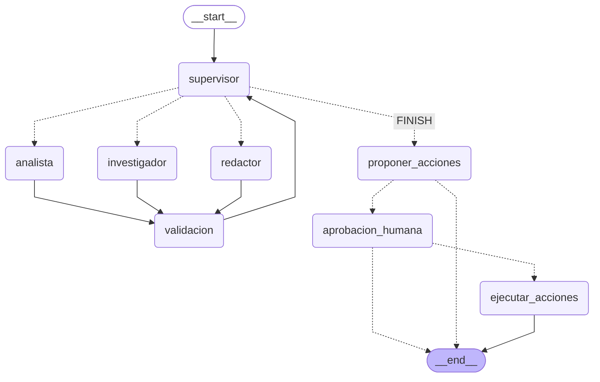

# API de producción y monitoreo activo: orquestador multi-agente de Gobierno de Datos

Pre-entrega 7 (Módulo 7) del curso de AI Engineering. Tomé el orquestador multi-agente de la pre-entrega 6
(un supervisor que delega en un investigador, un analista y un redactor, sobre datos **ficticios** de calidad de datos de
Mercado Austral S.A.) y lo convertí en un servicio que se puede operar: una API asíncrona, estado y checkpoints en
Redis, un paso de aprobación humana antes de ejecutar acciones con efecto externo, trazas en Arize Phoenix y una
prueba de carga con 5 peticiones concurrentes.

## Cómo interpreté la consigna (decisiones)

| Tema | Qué decidí | Por qué |
|---|---|---|
| Cómo corre el agente | La API **no** corre el grafo: `POST /tasks` registra el job y lo encola en Redis; lo ejecuta un **worker** en otro proceso. | Un flujo de agentes tarda decenas de segundos. Con `BackgroundTasks` correría en el mismo proceso que la API: un reinicio perdería los jobs y no se podría escalar. Con cola y worker, la API responde en milisegundos y se pueden sumar workers. |
| Redis | Una sola instancia con **tres usos**: registro del job (`job:{id}`), cola (`cola:tareas`) y **checkpoints de LangGraph** (`thread_id = job_id`). | Es lo que pide la consigna, y el `job_id` une todo: el job, su checkpoint y su traza. |
| Estados | `PENDING` → `RUNNING` → (`WAITING_APPROVAL` →) `DONE` o `FAILED`. | El job se guarda como `PENDING` **antes** de encolarse, así que nunca hay un mensaje en la cola sin registro. Cualquier excepción del grafo lo deja en `FAILED` con el motivo; también si supera su tiempo máximo (`JOB_TIMEOUT_SEGUNDOS`, 300 s) o si su worker muere: cada worker barre cada 30 s los jobs que llevan en `RUNNING` más que el timeout y los pasa a `FAILED`, para que ningún cliente haga polling sin fin. |
| Acción con efecto externo | **Escalar** un incidente crítico con el SLA vencido a su responsable. Es una acción *simulada* (queda anotada en la lista `escalaciones:enviadas` de Redis). | Es una acción que sale naturalmente del análisis que ya hacía el agente, y que conviene que revise una persona. |
| Aprobación | El grafo se pausa con `interrupt` en el nodo `aprobacion_humana`; `POST /tasks/{id}/approve` entrega la decisión y el worker lo retoma. Si **rechazan**, el job termina en `DONE` sin ejecutar nada. | La pausa vive en el checkpoint de Redis, no en memoria: cualquier worker puede retomarlo, incluso después de un reinicio. |
| Observabilidad | **Arize Phoenix** (se levanta con Docker Compose) con el estándar OpenInference. | Se engancha a LangGraph sin decorar funciones: cada nodo, cada llamada a Claude y cada herramienta es un span. |
| Costo y p95 | Los calculo en el dashboard de Phoenix (tokens × precio del modelo; percentil 95 de la latencia de las trazas). El script de carga guarda además su propio resumen para contrastar. | La consigna pide las capturas del dashboard. |

## Cómo está armado



El mismo diagrama, generado por LangGraph a partir del grafo real, está en [docs/grafo.mmd](docs/grafo.mmd) y como imagen en
[docs/grafo.png](docs/grafo.png) (`make diagrama` los regenera; un test falla si el grafo cambia y el diagrama no).
Hasta `validacion` es el núcleo de la pre-entrega 6 sin cambios de lógica; lo nuevo es lo que sigue a `FINISH`:
`proponer_acciones` calcula qué incidentes críticos vencidos hay que escalar, `aprobacion_humana` pausa el grafo y
`ejecutar_acciones` solo corre si hay una aprobación registrada (tiene una segunda guarda propia).

```
POST /tasks ──► job:{id} = PENDING ──► cola:tareas ──► worker ──► grafo (checkpoints en Redis)
                      ▲                                   │             │
GET /tasks/{id} ──────┘ (estado, resultado, tokens)       │             └─ interrupt ─► WAITING_APPROVAL
POST /tasks/{id}/approve ──► decisión + mensaje "reanudar" ┘                               │
                                                             worker retoma con Command(resume=decisión)
```

### Estructura del repositorio

| Ruta | Qué hay |
|---|---|
| [app/main.py](app/main.py) | La API FastAPI: `POST /tasks`, `GET /tasks/{id}`, `GET /health`. |
| [app/hitl.py](app/hitl.py) | La aprobación humana: nodos del grafo y `POST /tasks/{id}/approve`. |
| [app/worker.py](app/worker.py) | El worker: toma jobs de la cola, corre el grafo, publica el resultado o el `FAILED`. |
| [app/graph.py](app/graph.py) | Arma el grafo de producción y abre el checkpointer de Redis. |
| [app/observability.py](app/observability.py) | Conexión a Phoenix y etiquetas de cada traza. |
| [app/jobs.py](app/jobs.py), [app/schemas.py](app/schemas.py), [app/settings.py](app/settings.py), [app/notificador.py](app/notificador.py) | Estado de los jobs en Redis, contratos de la API, configuración y la acción simulada. |
| [orquestador/](orquestador/) | El núcleo multi-agente de la pre-entrega 6 (supervisor, especialistas, validación, herramientas). |
| [scripts/](scripts/) | [carga.py](scripts/carga.py) es la prueba de carga; [verificar_entorno.py](scripts/verificar_entorno.py) comprueba el Redis real; [corrida_real.sh](scripts/corrida_real.sh) y [chequeo_inicial.sh](scripts/chequeo_inicial.sh) arman todo y dejan sus registros en `docs/evidencia/`. |
| [tests/](tests/) | Pruebas con modelos falsos (no gastan la API de Anthropic) y Redis simulado. |
| [docker-compose.yml](docker-compose.yml), [Dockerfile](Dockerfile), [requirements.txt](requirements.txt), [.env.example](.env.example) | Cómo levantarlo. |
| `screenshots/`, [docs/evidencia/](docs/evidencia/) | Evidencia: capturas de Phoenix (trazas, costo por ejecución y p95) y los registros de la corrida real. |

## Cómo levantarlo

Necesitás Docker y una clave de la API de Anthropic (y Python 3.12 o más nuevo si usás la opción B).

```bash
cp .env.example .env        # y pegá tu ANTHROPIC_API_KEY en .env (el archivo está en .gitignore)
```

### Opción A: todo en contenedores (un comando)

```bash
docker compose up --build
```

Levanta Redis, Phoenix (http://localhost:6006), la API (http://localhost:8000, documentación interactiva en `/docs`) y un worker.
Para más capacidad: `docker compose up --build --scale worker=2`.

### Opción B: infraestructura en Docker, API y worker en tu terminal (para desarrollar)

```bash
python3 -m venv .venv && source .venv/bin/activate
pip install -r requirements.txt

docker compose up -d redis phoenix     # Redis 8 y Phoenix
python scripts/verificar_entorno.py    # (opcional) comprueba Redis, checkpoints, pausa y reanudación; no gasta API

# en una terminal:
uvicorn app.main:app --port 8000
# en otra terminal:
python -m app.worker
```

> **Redis tiene que ser 8+ o Redis Stack.** El checkpointer de LangGraph usa los módulos de búsqueda y JSON, que Redis 8 trae
> incluidos. Si usás otro Redis, el worker se detiene al arrancar con un mensaje que lo explica.

## Probarlo a mano

```bash
# 1) Encolar una tarea: responde al instante con el job_id (202)
curl -s -X POST localhost:8000/tasks -H 'content-type: application/json' \
  -d '{"tarea": "Priorizá los incidentes críticos abiertos del maestro de artículos."}'
# {"job_id":"…","estado":"PENDING","consultar_en":"/tasks/…"}

# 2) Consultar el estado (repetir hasta que cambie)
curl -s localhost:8000/tasks/<job_id>

# 3) Si quedó en WAITING_APPROVAL, la respuesta trae en "aprobacion_pendiente" las acciones a revisar.
#    Aprobar (o poner "aprobada": false para rechazar):
curl -s -X POST localhost:8000/tasks/<job_id>/approve -H 'content-type: application/json' \
  -d '{"aprobada": true, "revisor": "Cris", "comentario": "Escalar ambos"}'

# 4) Cuando esté en DONE: "resultado" tiene el informe y qué acciones se ejecutaron
docker compose exec redis redis-cli LRANGE escalaciones:enviadas 0 -1     # los avisos "enviados" (simulados)
```

Los errores más comunes devuelven códigos claros: `422` si la tarea es inválida, `404` si el job no existe (o el ID no tiene el formato de un `job_id`), `409` si se aprueba
un job que no está esperando aprobación (o ya recibió una decisión), `503` si Redis no responde.

## Reproducir la prueba de carga (5 peticiones concurrentes)

Con la API y el worker andando (opción A o B):

```bash
python scripts/carga.py --precio-entrada 1 --precio-salida 5
```

El script dispara 5 `POST /tasks` **a la vez**, consulta cada job hasta que termina y muestra, por job, cuánto tardó la API en
aceptarlo, la latencia total y los tokens; al final calcula el **p50 y el p95** y el costo promedio por ejecución, y guarda el resumen en
`docs/evidencia/carga-<fecha>.json`. Los precios (USD por millón de tokens, aquí los de Claude Haiku 4.5) son opcionales: sin ellos
el script igual mide latencias y tokens, y el costo lo calcula Phoenix. Por defecto usa 5 consultas sobre el maestro de sucursales, que no tiene incidentes críticos y por lo
tanto no se pausa. Con `--perfil con-aprobacion` usa consultas con incidentes críticos y el script aprueba cada pausa automáticamente.

Para repetir exactamente lo que hice yo, con Phoenix limpio (así el dashboard muestra solo las 5 ejecuciones):

```bash
docker compose down -v                 # borra los datos de Redis y de Phoenix
bash scripts/corrida_real.sh carga     # levanta todo y lanza las 5 peticiones
bash scripts/corrida_real.sh hitl      # una tarea con aprobación humana
```

Después, en Phoenix (http://localhost:6006), proyecto `orquestador-gobierno-de-datos`: la pestaña *Metrics* muestra el p95 y el costo; *Traces*, cada ejecución
con su latencia y su costo; *Sessions*, las trazas agrupadas por `job_id`.

## Observabilidad

Cada ejecución es una traza con un span por nodo del grafo, por llamada a Claude (con sus tokens de entrada y salida) y por herramienta.
Los spans llevan `session.id = job_id`, el `job_id` en los metadatos y la versión de los prompts (`VERSION_PROMPTS`), así que puedo
llegar de un job de la API a su traza y relacionar un cambio de comportamiento con un cambio de prompt. Si Phoenix no está disponible, el worker
sigue funcionando sin trazas (lo avisa en el log): el monitoreo no tiene que tirar abajo lo que monitorea.

Dos detalles que me costó descubrir en la corrida real: la imagen actual de Phoenix pide login y rechaza las trazas con un 401, así que en el Compose lo dejé sin autenticación
(`PHOENIX_ENABLE_AUTH=false`, solo para uso local); y el SDK de Anthropic 2.x emite por su cuenta un span extra por cada llamada, que quedaba como una
traza suelta y falseaba el p95, así que lo apago con `ANTHROPIC_OPEN_TELEMETRY=false` (ver [app/observability.py](app/observability.py)).

## Lectura del dashboard (5 peticiones concurrentes)

Corrí la prueba sobre un Phoenix recién creado, así que el dashboard muestra **solo** las 5 ejecuciones
(5 trazas, 66 llamadas a Claude, todas en `DONE`). Los comandos y los resúmenes completos están en
[docs/evidencia/](docs/evidencia/); las capturas, en `screenshots/`.

| | Resultado | Dónde se ve |
|---|---|---|
| Latencia p95 | **35,31 s** (p50 32,69 s, máxima 35,60 s) | [captura del p95](screenshots/p95-latencia-5-concurrentes.png), pestaña *Metrics* |
| Costo por ejecución | **USD 0,04 a 0,05** cada una; unos **USD 0,24** las cinco (USD 0,16 de entrada y USD 0,08 de salida) | [tabla por traza](screenshots/costo-por-ejecucion-tabla.png) y [costo total](screenshots/costo-total-5-concurrentes.png) |
| Árbol de una ejecución | `supervisor`, `investigador`, `analista`, `redactor`, `validacion` y las herramientas, con cada llamada a Claude | [traza de un job](screenshots/traza-arbol-de-un-job.png) |
| Pausa y reanudación | La tarea se pausa en `aprobacion_humana` y, al aprobarla, se retoma y ejecuta las acciones (dos trazas de la misma sesión) | [pausa](screenshots/traza-hitl-1-pausa.png) y [reanudación](screenshots/traza-hitl-2-reanudacion.png) |

El script de carga mide por su lado: p50 33,18 s y p95 36,20 s (desde que se envía hasta que el job termina, con
la espera en la cola y el sondeo de cada segundo) y USD 0,0472 por ejecución con los precios de Claude Haiku 4.5 (USD 1 por millón
de tokens de entrada y USD 5 por millón de salida). Los promedios de tokens coinciden con los de Phoenix (34.967 por ejecución); la
diferencia en el p95 es de método (Phoenix interpola y mide solo la traza) y de punto de medición.

**Qué leo en esos números**

- **Correr 5 a la vez no las hizo más lentas.** Un job solo tardó 33,2 s y el p50 de los cinco fue 32,7 s. La API aceptó cada petición en
  0,01 s como máximo: no espera al modelo, y el worker corre los 5 jobs en paralelo.
- **La latencia sale de la cadena de llamadas, no de las herramientas.** Cada ejecución encadena unas 13 llamadas a Claude en serie
  (66 en total entre las 5, de 2,4 s en promedio y hasta 4,4 s); las herramientas (consulta de incidentes, cálculo de SLA) tardan 2 ms en promedio y 4 ms como máximo
  (64 llamadas medidas en Phoenix, con las dos pruebas).
  Para bajar el p95 habría que reducir la cantidad de llamadas encadenadas, no acelerar las herramientas.
- **Dónde se consumen los tokens:** investigador **36 %**, analista **31 %**, supervisor **26 %** y redactor **7 %** (174.836 tokens entre las 5). Dos tercios del
  costo son tokens de **entrada**: el contexto que se vuelve a enviar en cada llamada pesa más que lo que Claude escribe.
- **Lo que haría con esto (hipótesis, no las probé):** recortar el contexto que reciben el investigador y el analista, y probar el caché de prompts
  para las partes que no cambian. Son las dos palancas que atacan donde está el costo.
- **Cuidado con el p95:** con 5 muestras es casi el máximo. Sirve para ver que la cola de la distribución no se dispara, no para prometer un
  SLA; para eso haría falta una prueba con decenas o cientos de peticiones.

## Pruebas

```bash
pytest          # sin claves ni Redis: usa modelos falsos y Redis simulado
mypy .          # tipos
```

Las pruebas cubren, entre otras cosas: que la API devuelve el `job_id` sin esperar al grafo y sigue respondiendo con el worker ocupado,
que 5 jobs corren *a la vez* (no uno tras otro), que cualquier excepción deja el job en `FAILED`, que no se ejecuta ninguna acción sin aprobación,
que una aprobación no se puede dar dos veces, que el estado sobrevive a la serialización de Redis con sus modelos, y que las trazas
tienen un span por nodo y no mezclan jobs concurrentes. Para correr las pruebas de la cola y del almacén contra un Redis real:
`REDIS_URL_TEST=redis://localhost:6379 pytest`.

## Límites que conozco

- **Si el worker se cae a mitad de un job**, el job no se retoma solo: a los 6 minutos (timeout + 60 s) un barrido lo pasa a `FAILED` con el motivo y el cliente tiene que volver a enviarlo. El checkpoint sí queda en Redis, así que reencolarlo automáticamente sería posible. Con `docker compose stop` el worker espera hasta 2 minutos a que terminen los jobs en curso, así que un apagado normal no los pierde. Si el worker cae justo después de sacar un mensaje de la cola y antes de marcarlo `RUNNING`, el job queda en `PENDING` (ventana de milisegundos; el barrido solo mira `RUNNING`).
- **No hay vencimiento para las aprobaciones**: un job puede esperar indefinidamente (hasta que expire por TTL, 7 días por defecto).
- **El escalamiento es simulado**: queda anotado en Redis, no se envía ningún mail ni mensaje.
- **No hay autenticación** en la API ni identidad verificada del revisor (`revisor` es texto libre). Para producción real iría detrás de un proveedor de identidad.
- **Con 5 muestras el p95 es simplemente la latencia más alta** (método de rango más cercano). Es el número que pide la consigna, pero estadísticamente informa poco.
- **Probado solo con Anthropic.** Bajo carga real podría haber respuestas 429 del proveedor; el job quedaría en `FAILED` con el motivo.
- La imagen de Phoenix en el Compose está en `latest`, y para reproducibilidad estricta habría que fijarle una versión; en la que usé hubo que desactivar el login (ver más arriba).
- Una tarea con aprobación genera **dos** trazas en Phoenix (hasta la pausa y desde la reanudación); se ven juntas en *Sessions*.
- Los datos (Mercado Austral S.A.) son ficticios.
